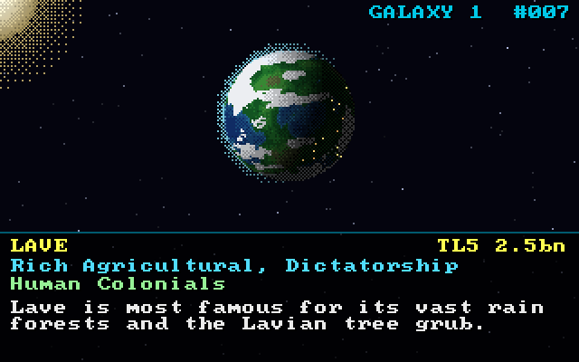

# elite

The galaxy generator of *Elite* (1984, David Braben and Ian Bell) rebuilt in Rust, with a small 320x200 explorer to fly through the result.



After watching a video on how Elite squeezed eight galaxies of 256 star systems each into a handful of bytes, I wanted to rebuild the generator as faithfully as possible. Where Ian Bell's C port and the original 6502 code disagree, this follows the 6502.

## How it works

Galaxy 1 starts from three 16-bit words, `0x5A4A 0x0248 0xB753`. Each system reads its name, position, economy, government, tech level, population, species and description from masked bits of that seed, and four Tribonacci-style twists (`s0, s1, s2 = s1, s2, s0 + s1 + s2`) lead to the next one. To change galaxy, each seed byte is rotated left by one bit; an 8-bit rotation is back where it started after eight steps, so galaxy 9 is galaxy 1 again and the galactic hyperdrive goes round in a circle of eight.

## Findings

All 2048 systems match Ian Bell's `txtelite.c`, except for

- 383 species, where txtelite masks the size adjective with `& 3` instead of the 6502's `AND #%00000111` (and turns Tiraor's "Blue Fat Insects" into "Fierce Blue Fat Insects"), and
- 7 descriptions, where a made-up word starting with the blank syllable `..` loses its capital letter.

Also, the phrase table lists "ice bergs" and "dust clouds", yet the description RNG never picks them: 2048 planets, and not a single iceberg.

## The explorer

The explorer draws every frame on the CPU and shows it via [game-toolkit](https://github.com/sunsided/game-toolkit). A planet's look follows its description (rain forests, oceans, plantations, volcanoes, civil war, solar activity) and falls back to economy and tech level; since nothing mentions ice, some poor industrial worlds are frozen.

| Key | Action |
|---|---|
| ← / → | Previous or next system; hold to zip through |
| ↑ / ↓ | Hyperspace to the next or previous galaxy |
| Tab | Galactic chart |
| Space | Pause planet rotation |

## Usage

```bash
task run                # the explorer
task cli -- show Lave   # one system's data sheet and description
task ci                 # formatting, clippy and tests
```

`task` lists the rest.

## Credits

The tables and bit layouts follow Ian Bell's `txtelite.c` and Mark Moxon's fully annotated BBC Micro source at [elite.bbcelite.com](https://elite.bbcelite.com), without which the two disagreements above would have stayed guesses. This project isn't affiliated with Frontier Developments or the original authors.
